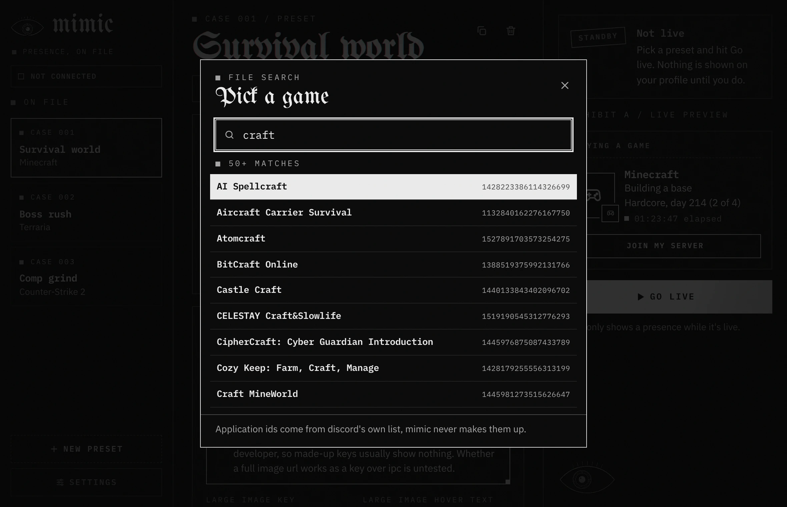
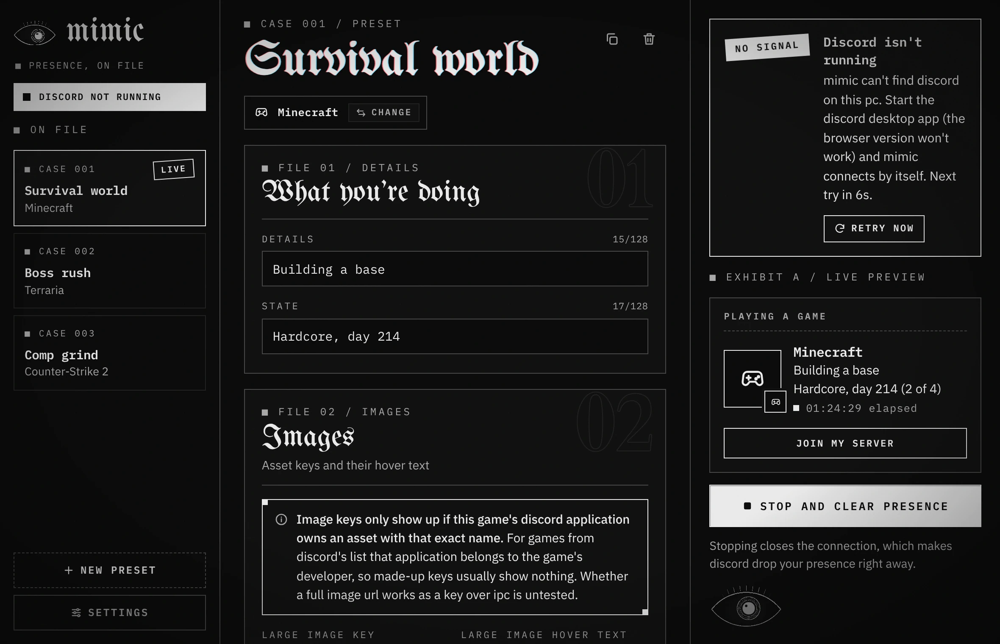

> **License:** source-available, view and learn only. Not open source. See [LICENSE](LICENSE) before cloning, forking or using this code.

# Mimic

Mimic a game on your discord rich presence, so you can be the best larp in the world.


Pick any game from discord's own list, write what your profile should say, and go live. A preview card updates as you type.

**Windows is tested and works. macOS and Linux builds are new and haven't been tried on real hardware yet.**

<p>
  
  
</p>

<sub>Screenshots show the real interface with sample presets.</sub>

## Features

- Searchable picker over about 25,000 games, taken from discord's public list (ids are never typed in by hand)
- Details, state, large and small image keys, elapsed timer, party size and up to two buttons
- Saved presets, quick switch from the tray, and your last preset comes back on launch
- Clear error states: discord not running, bad application id, rate limited, invalid button url
- Tray icon, close to tray, launch at login

## Install

Windows installers are on the [Releases](../../releases) page. For macOS and Linux, or the latest unreleased Windows build, open the newest green **build** run under **Actions** and download the `mimic-windows`, `mimic-macos` or `mimic-linux` artifact.

- **Windows:** run the `.exe` or `.msi`. They aren't code signed, so SmartScreen warns: click **More info**, then **Run anyway**.
- **macOS:** open the `.dmg` and drag mimic into Applications. It's one universal build for Apple silicon and Intel, not notarized, so the first launch is blocked: open **System Settings > Privacy & Security** and click **Open Anyway**.
- **Linux:** install the `.deb` (`sudo apt install ./mimic_*.deb`) or make the `.AppImage` executable and run it. The tray icon needs an appindicator host (GNOME needs the AppIndicator extension).

Start the **discord desktop app** first (the browser version can't work), then open Mimic, make a preset and hit **Go live**.

## How it works

Discord's desktop app listens on a local socket (a named pipe on Windows, a unix socket on macOS and Linux, including the flatpak and snap installs). Mimic connects to it, says which game it is (that game's application id), and sends the status you wrote. Switching games opens a fresh connection with the new id; stopping closes it, which makes discord drop the presence. Updates are batched to stay inside discord's rate limit of about one per 15 seconds. The protocol is written up in [`shared/README.md`](shared/README.md).

## Good to know

- **Image keys** only show if the game's discord application owns an asset with that exact name, which usually isn't the case for keys you make up. Whether a full image url works as a key is untested.
- **Buttons** are never visible on your own profile, only to other people.
- **The elapsed timer** keeps running while you edit, and only restarts when you change the timer setting.

## Build from source

You need [Rust](https://rustup.rs), [Node.js](https://nodejs.org) 22+ and, per platform:

- **Windows:** the MSVC toolchain (Visual Studio Build Tools, "Desktop development with C++") and WebView2 (already on current Windows)
- **macOS:** the Xcode command line tools (`xcode-select --install`)
- **Linux:** `libwebkit2gtk-4.1-dev libayatana-appindicator3-dev librsvg2-dev libxdo-dev libssl-dev` (Debian/Ubuntu names)

Mimic is a [Tauri 2](https://tauri.app) app, chosen over egui because the live preview and the look are far easier to get right in html and css. One codebase builds for all three; the only platform specific code is the socket connector in `app/core/src/ipc/`.

From `app/`:

```sh
npm install
npm run tauri dev      # run it
npm run tauri build    # bundles land in target/release/bundle/
cargo test             # the core crate's tests, runs on any os
```

`npm run dev` opens just the interface in a browser with a fake backend, handy for styling work.

## Testing a build

Try: connect and go live, edit every field, switch games (sidebar and tray), stop, minimize and close to tray, launch at login, and quit discord while live (Mimic should reconnect and bring the presence back by itself).

If something breaks, send what you did, your os and version, whether discord is Stable, PTB or Canary (and on Linux whether it's a deb, flatpak or snap), and the newest `.log` from:

- Windows: `%LOCALAPPDATA%\io.github.ag0nyy-ops.mimic\logs`
- macOS: `~/Library/Logs/io.github.ag0nyy-ops.mimic`
- Linux: `~/.local/share/io.github.ag0nyy-ops.mimic/logs`

## Layout

```
shared/      protocol notes, preset schema and the game list (made by scripts/fetch-games.mjs)
app/
  core/      all the logic, tested anywhere; ipc/ holds the per-os socket code
  src-tauri/ the Tauri shell: tray, window, autostart (tauri.<os>.conf.json picks the bundles)
  src/       the interface (TypeScript, no framework)
```

The look is a black and white "classified file" style. Its fonts (UnifrakturMaguntia, IBM Plex Mono and Sans) are bundled under the SIL Open Font License, with the licence texts in `app/src/assets/fonts/`, and the interface loads nothing from the internet.

## Disclaimer

For personal and novelty use. Faking a rich presence may conflict with Discord's Terms of Service and could put your account at risk. Use it at your own risk. Not affiliated with or endorsed by Discord.

## License

Source-available, view and learn only. See [LICENSE](LICENSE).

Not covered by it: `shared/games.json` is a list of game names and application IDs that come from Discord, and the bundled fonts stay under the SIL Open Font License (see above).
